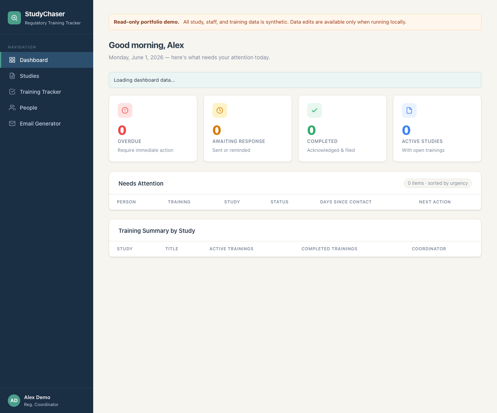

# StudyChaser

StudyChaser is a read-only portfolio demo of a regulatory training tracker for clinical study teams. It uses synthetic demo data to show how coordinators could monitor protocol and amendment training, spot overdue acknowledgments, and preview follow-up emails for study staff.

This public deployment is not production clinical or regulatory software. The hosted demo blocks data writes; local development can still exercise create, update, and delete routes.

## Live Demo

```text
https://studychaser.katalinalondono.com/
```

## Why This Exists

Clinical trial teams often track protocol and amendment training through a mix of spreadsheets, inbox follow-up, shared drives, and memory. That makes it easy to lose sight of who still owes training, which study is affected, what was last sent, and what should be filed for audit readiness.

StudyChaser turns that workflow into a small product surface: study-level status, staff-level accountability, overdue training, coordinator ownership, and previewable follow-up language.

## Project Structure

```text
frontend/   React and Vite web app, route views, API client, and production redirects
backend/    Node.js API, data store, tests, and Cloudflare Worker deployment config
shared/     Assignment counts, email eligibility, completion, and filing rules
```

## What It Does

This feature list describes the repository version; the live demo may differ while changes are under local review.



- Shows follow-ups due and evidence awaiting filing as separate work queues, with direct links to the matching records.
- Derives dashboard, study, and people counts from the same staff assignments. A staff record represents one person assigned to one training item; filing is a separate state on that record.
- Lists synthetic active studies with PI, coordinator, sponsor, and IRB details.
- Tracks training completion separately from evidence filing, with completed records still visible while filing is outstanding.
- Opens a training detail panel with version, coordinator, staff records, and activity history filtered by staff member.
- Records local completion and filing changes as separate dated events. Filing requires a completion record and a document location/reference.
- Labels authored sample history as synthetic and keeps email-preview activity separately in browser-session storage. Previews never send email or change the training record.
- Opens person-specific training records from People, with study, staff, and work-status filters in the tracker. Training groups start collapsed and have expand/collapse controls.
- Generates preview-only follow-up emails with assignment and completion checks. Completed assignments allow confirmation only. PI escalation addresses the recorded PI rather than the person owing training; an overdue PI receives a direct reminder.

## Run Locally

Start the backend API:

```bash
cd backend
npm install
npm start
```

The backend runs at:

```text
http://127.0.0.1:4000
```

Start the frontend app in a second terminal:

```bash
cd frontend
npm install
npm run dev
```

The frontend usually runs at:

```text
http://localhost:5173
```

If that port is busy, Vite will choose the next available local port.

## Backend API

The hosted Cloudflare Worker is read-only for portfolio review. It allows safe dashboard/review flows and email preview generation while blocking mutation routes in production.

Public demo routes are:

```text
GET  /api/health
GET  /api/dashboard/summary
GET  /api/studies
GET  /api/people
GET  /api/trainings
POST /api/email/generate
```

Local development also includes write routes for experimenting with the workflow. See `backend/README.md` for the local route list and example requests.

## Architecture Notes

- The frontend is a Vite/React app with route views for dashboard, studies, staff, training records, and email preview workflows.
- The backend exposes a small Node.js API that can run locally as an HTTP server or deploy as a Cloudflare Worker.
- Production/demo mode uses synthetic data and read-only protections so hiring reviewers can explore the workflow without creating or changing records.
- The read-only Worker serves its bundled synthetic dataset so published example histories stay in sync with the code. Writable local/Worker mode retains its existing file/KV store.
- Frontend fallback data and templates use the same synthetic seed and domain rules as the API. Legacy completion flags do not imply filing, and legacy filing locations do not imply a recorded event date.
- The bundled dataset has an explicit December 29, 2025 snapshot date. Contact ages are calculated from recorded contact dates relative to that snapshot, rather than combined with a live date. Locally stored datasets without a snapshot date use the current date.
- The data model is intentionally domain-specific: studies, people, training records, staff status, PI/coordinator ownership, IRB details, last-contact dates, and filing notes.
- Email generation is preview-only in the demo: it produces coordinator-ready follow-up language without sending real messages.

## What I Would Build Next

- Authentication and role-based permissions for coordinators, PIs, regulatory staff, and read-only reviewers.
- A production audit trail with authenticated actors, controlled record changes, retention, and validation. The current activity history is a portfolio demonstration.
- Notifications for overdue training and amendment acknowledgments.
- CSV/PDF export for monitoring visits, sponsor requests, and internal QA review.
- Integrations with CTMS/eTMF or document-management systems so training evidence and filing notes can connect to the rest of the clinical operations stack.
- More robust validation, pagination, filtering, and search for larger study teams.

## Verification

Run backend tests:

```bash
cd backend
npm test
```

Build the frontend:

```bash
cd frontend
npm run build
```

## Tech Stack

- React 18
- React Router
- Vite
- Node.js HTTP server
- JSON-backed local data store
- Plain CSS

## Status

The frontend is connected to the backend API for dashboard data, studies, people, trainings, and email generation. The production build is configured as a read-only synthetic demo. The API can run locally with Node or on Cloudflare Workers with KV-backed storage.
